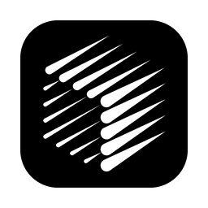
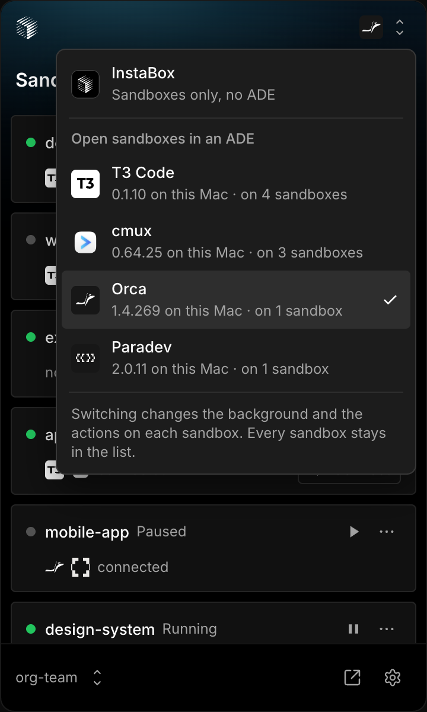
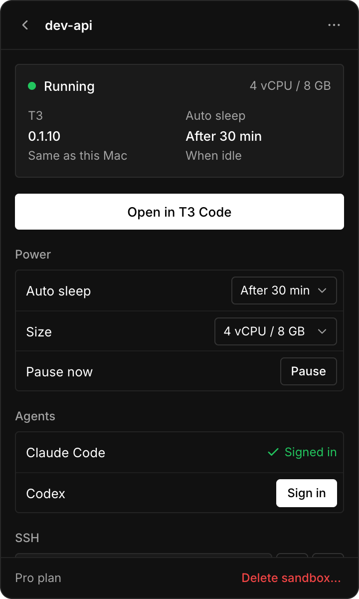

<div align="center">
  <a href="https://instabox.sh">
    
  </a>

  <h1>InstaADE</h1>

  <p>Run your ADE (agentic development environment) on an instabox sandbox, from your menu bar or system tray.<br>Works with T3 Code, cmux, Orca, Paradev and Herdr.</p>

  <p>
    <a href="LICENSE"></a>
    <a href="https://github.com/InsForge/instaADE/releases/latest"></a>
    
  </p>
</div>

<p align="center">
  
  
  
  
</p>

## Getting Started

You need macOS or Windows (x64) and an [instabox](https://instabox.sh) account. To open sandboxes in an ADE, you also need its desktop app: [T3 Code](https://github.com/pingdotgg/t3code/releases/latest) or [Orca](https://github.com/stablyai/orca/releases/latest) on macOS or Windows, [cmux](https://github.com/manaflow-ai/cmux/releases/latest) or [Paradev](https://github.com/paradevai/paradev/releases/latest) on macOS. [Herdr](https://herdr.dev) has no desktop app: it runs on the sandbox and opens in your terminal.

1. Download the latest release from [Releases](https://github.com/InsForge/instaADE/releases/latest):
   - macOS: the `.dmg`, `aarch64` for Apple silicon, `x64` for Intel.
   - Windows: the `x64-setup.exe` installer.
2. Install it:
   - macOS: drag InstaADE to Applications and open it. It is signed and notarized, so it opens normally.
   - Windows: run the installer. It is not signed yet, so Windows SmartScreen asks once: click **More info**, then **Run anyway**.
   - InstaADE was called Instabox before. On macOS, InstaADE asks a running Instabox to quit, or asks you to quit it when it does not, and offers to move it to the Trash. On Windows, the installer removes Instabox first. Your sign-in, your data and Start at login stay.
3. Click the InstaADE icon in the menu bar (macOS) or the system tray (Windows; at first it may be under the **^** arrow). If you cannot find it, see [Troubleshooting](#troubleshooting).
4. Sign in with GitHub or Google.
5. To open sandboxes in an ADE, pick T3 Code, cmux, Orca, Paradev or Herdr in the menu at the top (**InstaBox** keeps to sandboxes only). If you used T3 Code with InstaADE before, it starts in T3 Code.
6. Click **New sandbox**, pick a size, then click **Create sandbox**.
7. Confirm the new environment in T3 Code, or the workspace in cmux. In Orca, connect the host InstaADE names from the SSH menu. In Paradev, click **Set up a host over SSH**, paste the SSH address InstaADE copied, then click **Install Paradev** again. Herdr opens in your terminal with nothing to confirm.

## Features

- Create a sandbox or connect one you already have
- Pick T3 Code, cmux, Orca, Paradev or Herdr at the top: each sandbox gets **Open in** it, or **Install** it when the sandbox does not have it yet
- The popover takes on the look of the ADE you pick
- Set up the ADE on the sandbox the way it needs (see [Supported ADEs](#supported-ades))
- Use several ADEs on one sandbox: its details list each one with **Open**, and offer the other ADEs on your computer
- Pause, resume, resize and set auto sleep
- Copy the SSH command or open it in a terminal
- Sign in to Claude Code or Codex on the sandbox
- Starts at login (turn it off in Settings)
- Updates itself when you click **Update** in Settings. A dot on the Settings button means a new version is out

## Supported ADEs

| ADE | Desktop app on | How InstaADE opens a sandbox in it |
| --- | --- | --- |
| [T3 Code](docs/ades.md#t3-code) | macOS, Windows | Installs T3 on the sandbox and pairs it with the app |
| [cmux](docs/ades.md#cmux-macos) | macOS | Opens a `cmux://ssh` link, and cmux connects over SSH |
| [Orca](docs/ades.md#orca) | macOS, Windows | Adds the sandbox as an SSH host that Orca imports |
| [Paradev](docs/ades.md#paradev-macos) | macOS | Hands the host setup to Paradev, then opens a workspace on the host |
| [Herdr](docs/ades.md#herdr) | None (macOS, Windows) | Installs Herdr on the sandbox and opens it in your terminal over SSH |

Is your favorite ADE missing? Add it, or ask for it in an issue. See [CONTRIBUTING.md](CONTRIBUTING.md#add-an-ade).

- **T3 Code**: You need the T3 Code desktop app. **Install T3 Code** installs T3 on the sandbox at your app's version and pairs the two. Every **Open in T3 Code** wakes the sandbox and pairs again, so T3 Code gets the sandbox back even if it lost it.
- **cmux**: You need the cmux app in Applications. **Install cmux** and **Open in cmux** open the sandbox in cmux, which connects to it over SSH. InstaADE installs nothing on the sandbox for cmux.
- **Orca**: You need the Orca app, in Applications on macOS. **Install Orca** and **Open in Orca** wake the sandbox, add it as an SSH host and start Orca. Then connect the host InstaADE names from Orca's SSH menu, and open `/data/home`.
- **Paradev**: You need the Paradev app in Applications, not its Canary build. **Install Paradev** wakes the sandbox, puts its SSH address on the clipboard for one minute, and opens Paradev's host settings. In Paradev, click **Set up a host over SSH** and paste the address, then click **Install Paradev** in InstaADE again to open a workspace on the sandbox.
- **Herdr**: You need no Herdr app, only the OpenSSH client, which macOS has and recent Windows 10 and Windows 11 install by default. **Install Herdr** installs Herdr on the sandbox, then opens your terminal with an SSH session that runs Herdr there. **Open in Herdr** wakes the sandbox and does the same. Closing the terminal leaves Herdr and its agents running on the sandbox, and the next **Open in Herdr** attaches to them again.

**Your SSH config**: InstaADE changes it only for Orca. It adds one line at the top of `~/.ssh/config`, `Include ~/.ssh/instabox/config`, and copies the file to `~/.ssh/config.instabox.bak` before its first change. It keeps the Orca hosts in `~/.ssh/instabox/config`. That file holds SSH tokens, and on macOS only you can read it.

For how InstaADE works with each ADE, see [docs/ades.md](docs/ades.md).

## Troubleshooting

- **No InstaADE icon in the macOS menu bar.** When the menu bar is crowded, the icon can hide behind the notch. Hold Command and drag the icon to the right to bring it back. You can also open InstaADE again from Applications, which shows the popover.
- **The popover is in the way.** Drag it by its top bar.

## Roadmap

- More ADEs. Pull requests that add one are welcome.

## Development

For the code layout, adding an ADE, the checks to run before a pull request, preview builds and releases, see [DEVELOPMENT.md](DEVELOPMENT.md). Coding agents load the same guide through the `instabox-development` skill.

### Prerequisites

- macOS or Windows
- [Bun](https://bun.sh)
- Rust via [rustup](https://rustup.rs)
- macOS: Xcode Command Line Tools (`xcode-select --install`)
- Windows: Microsoft C++ Build Tools

### Setup

```bash
bun install
```

### Run with hot reload

1. Quit any installed copy of InstaADE (or Instabox, its old name). Only one instance runs at a time.
2. Run `bun tauri dev`.
3. Click the InstaADE icon in the menu bar or system tray.
4. Edit the code. UI changes reload at once, and Rust changes rebuild the app.

**Tips:**

- For browser-only UI development, run `bun run dev` and open `http://localhost:1420`. It shows labeled sample data; refresh to reset. Use the menu bar app for real sandbox and desktop actions.
- The default layout removes the hero and uses its colors as the app background, fading to black over the top 200px. Open `http://localhost:1420/?layout=hero` to compare the original hero layout.
- The browser preview never calls the app or the instabox API. Actions that need them, such as Open or Install, show an error there.
- Set `INSTABOX_API_URL` to point the app at another API.
- Set `INSTABOX_API_KEY` to sign in with an API key instead of the browser.
- You do not need an installer to see a change.
- A dev build never turns on Start at login by itself.

### Tests

```bash
bun run test
cd src-tauri && cargo test
```

### Build an installer

Only needed to test installing.

```bash
# macOS: src-tauri/target/release/bundle/dmg/
bun tauri build --bundles dmg

# Windows: src-tauri/target/release/bundle/nsis/
bun tauri build --bundles nsis
```

A local build is not notarized, so macOS blocks it on other Macs.

### Share a preview build

To let others try a pull request, build InstaADE Preview in CI. It installs next to InstaADE and keeps its own sign-in. The macOS `.dmg` is signed and notarized like a release. The Windows installer is not signed yet, so SmartScreen asks once.

1. Add the `preview-build` label to the pull request. The pull request's author must be listed in `.github/PREVIEW_AUTHORS`.
2. **Preview build** builds the app from the pull request without any secrets. **Preview publish** then runs main's code only: it checks the author and the app, signs and notarizes it, and takes the label off.
3. The files go to the `instabox-preview` prerelease, and the pull request gets a comment with direct links. They download without a GitHub account.
4. To build a newer commit, add the label again. Closing the pull request deletes its files.

## Contributing

Contributions are welcome, from new ADEs to new features and fixes. See [CONTRIBUTING.md](CONTRIBUTING.md).

- **Add your favorite ADE**: start with [Add an ADE](CONTRIBUTING.md#add-an-ade).
- **Add a feature or fix a bug**: open a pull request. For a large change, open an issue first.
- **Issues**: open an [issue](https://github.com/InsForge/instaADE/issues) for a bug, an idea or an ADE you want.

## License

This project is licensed under the MIT License. See the [LICENSE](LICENSE) file for details.
