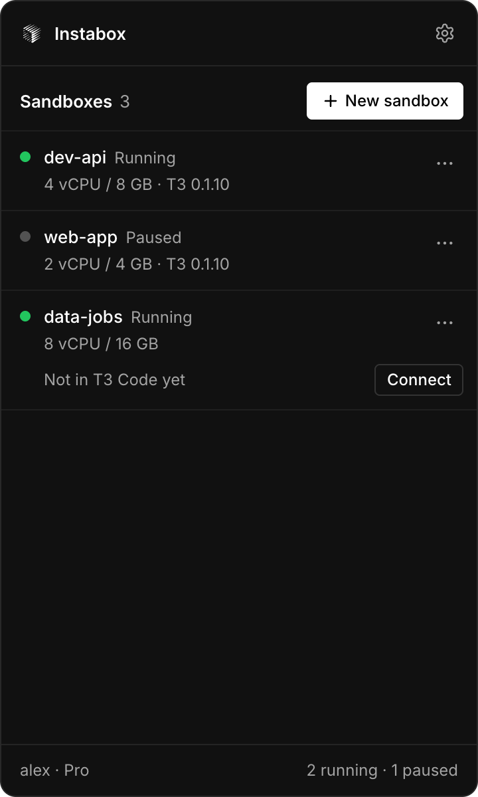
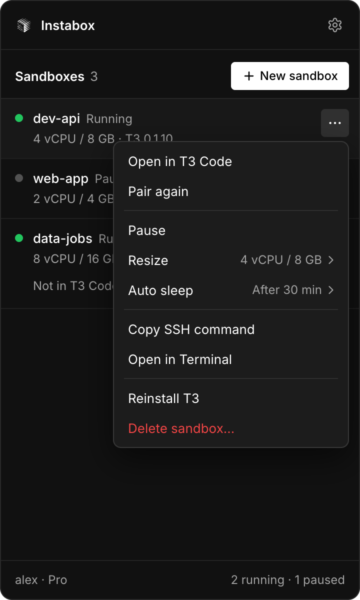

<div align="center">
  <a href="https://instabox.sh">
    
  </a>

  <h1>Instabox</h1>

  <p>Run T3 Code on an instabox sandbox from your menu bar.</p>

  <p>
    <a href="LICENSE"></a>
    <a href="https://github.com/InsForge/instabox-bridge/releases/latest"></a>
    
  </p>
</div>

<p align="center">
  
  
  
</p>

## Getting Started

You need macOS, the [T3 Code](https://github.com/pingdotgg/t3code/releases/latest) desktop app and an [instabox](https://instabox.sh) account.

1. Download the latest `.dmg` from [Releases](https://github.com/InsForge/instabox-bridge/releases/latest): `aarch64` for Apple silicon, `x64` for Intel.
2. Drag Instabox to Applications and open it. It is signed and notarized, so it opens normally.
3. Click the Instabox icon in the menu bar.
4. Sign in with GitHub or Google.
5. Click **New sandbox**, pick a size, then click **Create sandbox**.
6. Confirm the new environment in T3 Code.

## Features

- Create a sandbox or connect one you already have
- Installs T3 at the same version as your T3 Code
- Pause, resume, resize and set auto sleep
- Copy the SSH command or open it in Terminal
- Sign Claude Code or Codex in on the sandbox
- Starts at login (turn it off in Settings)

## What it installs on your sandbox

- T3 under `/opt/t3`
- A `t3-instabox` service that runs the T3 server
- An activity probe, so the sandbox sleeps only when T3 is idle

## Known limits

- A sandbox stays awake while T3 Code is connected to it. Pause it when you are done.
- macOS only for now. Windows is in progress.
- GitHub on a sandbox is manual: run `gh auth login` there, for example from **Open in Terminal**.
- T3 Code is the only supported tool for now.

## Adding another coding tool

- Sandbox side: `src-tauri/src/t3/remote.rs` holds the install, version and pairing scripts. `src-tauri/assets/t3-probe` is the idle probe.
- Mac side: `src-tauri/src/t3/desktop.rs` finds T3 Code and reads its version. `open_in_t3` in `src-tauri/src/app.rs` opens it.
- Flow: `src-tauri/src/sandbox/connect.rs` installs, pairs and marks a sandbox connected. `src-tauri/src/sandbox/sync.rs` keeps the versions in step.
- UI text such as "Open in T3 Code" is in `src/` (`Details.tsx`, `SandboxMenu.tsx`, `Setup.tsx`, `Progress.tsx`).
- A new tool needs an install script, a version check, a pairing or connect step, and an idle probe that prints `{"busy": true}` or `{"busy": false}`.

Pull requests that add a tool are welcome.

## Development

### Prerequisites

- macOS
- [Bun](https://bun.sh)
- Rust via [rustup](https://rustup.rs)
- Xcode Command Line Tools (`xcode-select --install`)

### Setup

```bash
bun install
```

### Run with hot reload

1. Quit any installed copy of Instabox. Only one instance runs at a time.
2. Run `bun tauri dev`.
3. Click the Instabox icon in the menu bar.
4. Edit the code. UI changes reload at once, and Rust changes rebuild the app.

**Tips:**

- Set `INSTABOX_API_URL` to point the app at another API.
- Set `INSTABOX_API_KEY` to sign in with an API key instead of the browser.
- You do not need a `.dmg` to see a change.
- A dev build never turns on Start at login by itself.

### Tests

```bash
bun run test
cd src-tauri && cargo test
```

### Build a .dmg

```bash
bun tauri build --bundles dmg
```

Only needed to test installing. The file lands in `src-tauri/target/release/bundle/dmg/`.

## Credits

Parts are adapted from [t3boat](https://github.com/paukraft/t3boat) by Pau Kraft (MIT). See [THIRD_PARTY_NOTICES.md](THIRD_PARTY_NOTICES.md).

## Contributing

**Pull requests**: Welcome. To add a coding tool, start with [Adding another coding tool](#adding-another-coding-tool).

**Issues**: Open an [issue](https://github.com/InsForge/instabox-bridge/issues) for bugs or ideas.

## License

This project is licensed under the MIT License. See the [LICENSE](LICENSE) file for details.
